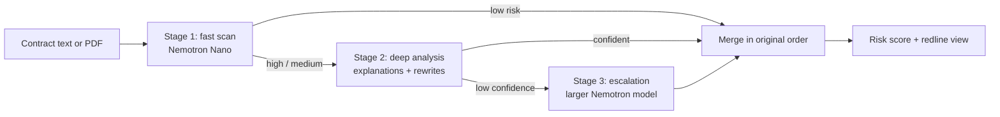

# Contract Risk Explainer ⚖️

**Paste a contract. See what's dangerous. Know what to ask for instead.**

Contract Risk Explainer reads leases, NDAs, terms of service and similar agreements, marks the risky clauses directly in the text like a lawyer's redline, explains each one in plain English, and suggests fairer wording you can propose back.

- 🔗 **Live demo:** https://unraval-murex.vercel.app/
- 🎥 **Demo video (under 3 min):** [ADD YOUTUBE LINK]
- 🏁 **Track:** Best Apps and Agents
- 📜 **License:** MIT

> Built for the Nebius x NVIDIA Global AI Hackathon. Built from scratch during the submission period (first commit September 2026).

---

## The problem

Most people sign contracts they don't fully understand. A lease may let the landlord enter without notice, keep the whole deposit at their discretion, or raise rent 15% on silent auto-renewal. A lawyer for every lease or freelance agreement isn't realistic, and a general chatbot only helps if you already know what to ask.

## What it does

1. **Paste text or upload a PDF.** No prompting skill needed.
2. **See risk in place.** The contract appears as a paper-style document with risky clauses marked in redline. Click a marked clause to see why it's risky.
3. **Plain-English explanations** for every flagged clause.
4. **Suggested fairer wording**, shown as a tracked change (original struck through, replacement beside it).
5. **An overall risk score from 0 to 100**, plus a High / Medium / Low breakdown.
6. **Two views:** the redline document view and a filterable clause-card view.

---

## How we use NVIDIA Nemotron and Nebius Token Factory

Every analysis makes live inference calls to **Nebius Token Factory** through its OpenAI-compatible endpoint (`https://api.tokenfactory.nebius.com/v1/`), using **NVIDIA Nemotron** open models. The app uses different model sizes for different jobs, so cost and latency stay low without giving up accuracy on hard clauses.

| Stage | Function | Model | Purpose |
|---|---|---|---|
| 1. Fast scan | `scan_clauses` | `nvidia/NVIDIA-Nemotron-3-Nano-30B-A3B` | Split the contract into clauses and give each a quick preliminary risk tier. Short prompt, low token cost. |
| 2. Deep analysis | `deep_analyze` | `nvidia/NVIDIA-Nemotron-3-Nano-30B-A3B` | Only for clauses flagged high or medium: finalized risk level, plain-English explanation, suggested rewrite, and a self-reported confidence. Low-risk clauses skip this call entirely. |
| 3. Escalation | `escalate_clause` | [ADD ESCALATION MODEL, e.g. a larger Nemotron-3 model] | Only for clauses where the model reported low confidence: a second opinion from a stronger model. Escalated clauses get a "verified by advanced model" badge. |

**Where Token Factory helped:** inference is fast enough that three sequential stages still finish in seconds, and the OpenAI-compatible API meant we could use the standard `openai` Python client with only a base URL change. The OpenAI-style `response_format` JSON mode is requested where the model supports it, and the app falls back gracefully when it doesn't.



Pipeline counts (clauses scanned, flagged, escalated) are returned with every response and shown in the UI, so the routing is visible rather than a black box.

---

## How the risk score is calculated

The 0 to 100 score is **deterministic Python math**, not a number invented by the model. The model only classifies each clause; the code does the rest:

- Each **high**-risk clause adds 35 points and each **medium**-risk clause adds 15.
- A proportional ratio (high counted fully, medium at 45%) normalizes for contract length.
- The two signals are blended, then clamped to 0-100.
- **Floor rules:** any high-risk clause forces a score of at least 65; otherwise any medium-risk clause forces at least 35; a contract with only low-risk clauses is capped at 20. One dangerous clause is never diluted by many harmless ones.

See `compute_overall_risk_score` in `app.py`.

---

## Evaluation

## Evaluation

We measure accuracy instead of assuming it. `eval_set.json` contains 15 labeled clauses across liability waivers, data ownership, auto-renewal, non-competes, arbitration, late fees, marketing rights, jurisdiction, termination, payment terms, confidentiality, force majeure and entire-agreement clauses. `eval.py` sends them to the model and compares predicted risk levels with the expected ones.

**Result: 12 of 15 correct (80%)** using `nvidia/NVIDIA-Nemotron-3-Nano-30B-A3B`.

| Expected risk | Correct |
|---|---|
| High | 5 / 5 |
| Medium | 2 / 5 |
| Low | 5 / 5 |

The model was reliable on clear-cut clauses: no dangerous clause was rated low and no harmless one was rated high. All three misses were in the gray middle tier:

- **Mandatory arbitration with a class-action waiver:** labeled medium, predicted high. Reviewers could reasonably disagree on this label.
- **Marketing and trade-name license:** labeled medium, predicted low (under-flagged).
- **90-day registered-mail termination notice:** labeled medium, predicted low (under-flagged).

**Scope and caveats:** the test set is small (15 clauses), the labels are judgment calls, and the benchmark scores isolated clauses with the Nano model only. It does not exercise the full contract pipeline or the Stage 3 escalation step. Treat it as a sanity check, not a certification of legal accuracy.

Reproduce with `python eval.py`.

---

## Run it locally

```bash
git clone https://github.com/GargiLaulkar/CONTRACTRISKMANAGER.git
cd CONTRACTRISKMANAGER
pip install -r requirements.txt
```

Create a `.env` file from `.env.example`:

```
NEBIUS_API_KEY=your_nebius_token_factory_key
NEBIUS_MODEL=nvidia/NVIDIA-Nemotron-3-Nano-30B-A3B
NEBIUS_ESCALATION_MODEL=your_escalation_model_id
```

Get a key from the Nebius Token Factory console. Model IDs can be listed with `curl https://api.tokenfactory.nebius.com/v1/models -H "Authorization: Bearer $NEBIUS_API_KEY"`.

```bash
python app.py                    # open http://127.0.0.1:5000
python eval.py                   # run the accuracy benchmark
python -m unittest test_app.py -v  # run logic tests
```

## Project structure

```
├── app.py            # Flask backend: 3-stage pipeline, scoring, PDF extraction
├── eval.py           # accuracy benchmark runner
├── eval_set.json     # 15 hand-labeled test clauses
├── test_app.py       # unit tests (mocked model)
├── requirements.txt  # flask, openai, python-dotenv, pypdf
├── .env.example      # environment template
├── LICENSE           # MIT
├── templates/
│   └── index.html    # UI: upload, redline view, clause cards
└── static/
    ├── style.css     # paper/redline design system
    └── script.js     # frontend logic and rendering
```

---

## Limitations (honest ones)

- **Not legal advice.** It's a fast first read to help people know what to ask, not a replacement for a lawyer.
- Risk classification is a model judgment, not a deterministic legal audit. It can miss things or over-flag, which is why the benchmark exists.
- The score saturates at 100 for contracts with several high-risk clauses, so it signals "don't sign without review" better than it separates a 78 from an 85.
- Scanned-image PDFs without extractable text aren't supported; paste the text instead.
- English-language contracts only, and no jurisdiction-specific legal checks yet.

## License

MIT. See [LICENSE](LICENSE).
